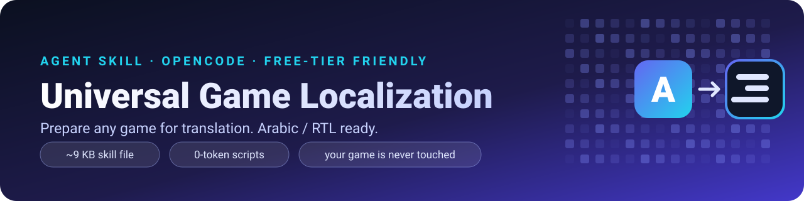
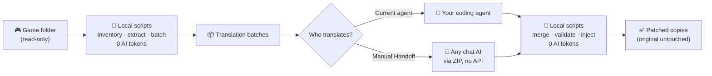
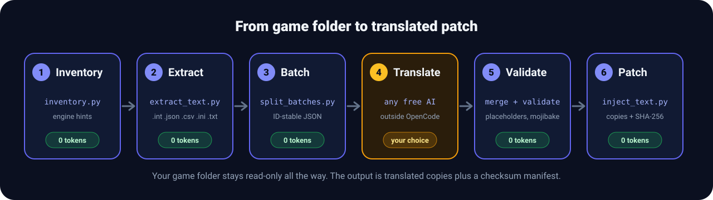

  

<h1 align="center">Universal Game Localization</h1>

  <strong>Localize games without burning your AI quota.</strong> 
  Python does the heavy lifting locally — the AI only translates. 
  Scan · Extract · Translate · Validate · Build &nbsp;|&nbsp; Arabic / RTL aware &nbsp;|&nbsp; <a href="#العربية">بالعربي ↓</a>

  
  
  
  
  
  

  <a href="#-install">Install</a> ·
  <a href="#-quick-start">Quick start</a> ·
  <a href="#-how-it-works">How it works</a> ·
  <a href="#-see-it-run">Demo</a> ·
  <a href="#-supported-text-formats">Formats</a> ·
  <a href="#-faq">FAQ</a> ·
  <a href="#-contributing">Contribute</a> ·
  <a href="#العربية">العربية</a>

Deep dives are in the expandable sections: <b>Manual Handoff</b>, <b>Engine adapters</b>, <b>Reverse mode</b>, <b>Script reference</b> and <b>Limitations</b>.

---

  <a href="https://github.com/ADMOSSx/Universal-Game-Localization/releases/latest"><strong>⬇ Get the latest release</strong></a>
  &nbsp;·&nbsp;
  <a href="https://github.com/ADMOSSx/Universal-Game-Localization/issues"><strong>Report an issue</strong></a>
  &nbsp;·&nbsp;
  <a href="https://github.com/ADMOSSx/Universal-Game-Localization/blob/main/CONTRIBUTING.md"><strong>Contribute</strong></a>

<table>
  <tr>
    <td align="center"><strong>0 AI tokens</strong> for local processing scripts</td>
    <td align="center"><strong>Read-only</strong> original game folder</td>
    <td align="center"><strong>Manual or AI</strong> your choice of translator</td>
    <td align="center"><strong>Windows + Linux</strong> automated test matrix</td>
  </tr>
</table>

## ✨ Why this exists

Most "AI localization" setups burn through free limits before a single string is translated. This skill flips that: **Python scripts handle the repetitive work locally, and the AI only handles translation and decisions that need language understanding.**

| | |
|---|---|
| 🪶 **Lean by design** | Short core instructions; detailed references are loaded only when needed. |
| 🧰 **Scripts, not tokens** | Inventory, extraction, deduplication, batching, merging, validation and patch-building run locally with no AI-token cost. |
| 🔒 **Your game stays untouched** | The game folder is read-only. Extraction and patching use a separate workspace and produce translated copies with source-hash checks. |
| 🌍 **Arabic / RTL aware** | Checks placeholders, markup, encoding damage, pre-shaped Arabic, bidi controls and length risks; includes legacy RTL helpers and in-game test guidance. |
| 🔁 **Translator choice** | Use the current agent/model, or choose Manual Handoff to translate through ChatGPT, Claude or another chat AI you can access. |
| 🧪 **Honest about limits** | Engine detection is evidence-based. Unsupported proprietary formats are reported as blocked instead of being guessed or silently rewritten. |

### 📊 Where the project stands

| Area | Status |
|---|---|
| Core pipeline (inventory → extract → batch → merge → validate → patch) | ✅ Covered by a synthetic regression suite; CI on Windows and Ubuntu, Python 3.10 and 3.12. |
| Real games | 🟡 Two documented reports: *Librerama 0.7.0* (Godot; Arabic verified in the tested main-menu/settings screens using a separate PCK/PO workflow) and *Hollow Knight 1.5* (Unity; partial Arabic). Neither report establishes full-game coverage. See [SUPPORTED_GAMES](docs/SUPPORTED_GAMES.md). |
| Binary containers (`.pak`, `.assets`, `.locres`, …) | 🚫 Detected and reported, not unpacked by the core scripts. |

---

## 🚀 Install

Needs [Node.js](https://nodejs.org). One command, global, for OpenCode:

~~~bash
npx skills add ADMOSSx/Universal-Game-Localization --skill universal-game-localization -g -a opencode -y
~~~

Restart OpenCode, then ask:

> Use the universal-game-localization skill. Analyze this game folder: D:\Games\MyGame. Prepare it for Arabic localization. Do not modify the original game.

<b>🤖 Let your AI agent install it</b>

Paste this into OpenCode (or another coding agent):

> Install the agent skill from https://github.com/ADMOSSx/Universal-Game-Localization. Run <code>npx skills add ADMOSSx/Universal-Game-Localization --skill universal-game-localization -g -a opencode -y</code>. If npx is not available, clone the repo and copy <code>skills/universal-game-localization</code> into <code>~/.config/opencode/skills/</code> (on Windows: <code>%USERPROFILE%\.config\opencode\skills\</code>). Then run <code>python scripts/selftest.py</code> inside that folder and confirm whether it prints <code>SELFTEST PASSED</code>.

<b>📦 Manual install / update</b>

Download the latest [v1.3.0 release ZIP](https://github.com/ADMOSSx/Universal-Game-Localization/releases/download/v1.4.0/universal-game-localization-1.4.0.zip). Extract the <code>universal-game-localization</code> folder and replace the previous installed folder with the complete new folder. Do not copy only <code>SKILL.md</code>: scripts, references and templates are required. The usual OpenCode global location on Windows is <code>%USERPROFILE%\.config\opencode\skills\universal-game-localization\</code>. Restart OpenCode after replacing it. Per-project installs (<code>.opencode/skills/</code>) also work; see the [OpenCode skills docs](https://opencode.ai/docs/skills).

<b>✅ Check that the scripts work on your machine</b>

Requires **Python 3.10+**.

~~~cmd
cd "%USERPROFILE%\.config\opencode\skills\universal-game-localization"
python scripts\verify_manifest.py
python scripts\selftest.py
~~~

The manifest check should print <code>MANIFEST PASSED</code>; the full self-test should finish with <code>SELFTEST PASSED</code>.

> [!NOTE]
> <code>npx skills</code> is a third-party CLI (from Vercel) that collects anonymous usage stats. Set <code>DO_NOT_TRACK=1</code> to disable it.

---

## 🏁 Quick start

The whole idea in one picture — the scripts do the repetitive work locally, and you only choose who translates:

**Through your agent (recommended):** install, restart, and use the prompt from the Install section. The skill walks through every step and asks who should translate.

<b>⌨️ Prefer the command line? The whole pipeline in 8 commands</b>

The scripts are plain Python (standard library) and run without any agent. Run them from the installed skill folder; use <code>python3</code> instead of <code>python</code> on Linux/macOS. <code>&lt;game&gt;</code> is your game folder and <code>&lt;ws&gt;</code> is a **separate** workspace folder — the scripts refuse to write into the game folder.

~~~bash
# 1-2. Look around (read-only)
python scripts/inventory.py "<game>" --out "<ws>/reports"
python scripts/engine_adapters.py "<game>" --out "<ws>/reports/ENGINE_ADAPTERS.json"

# 3. Extract supported plain-text strings (default target language: ar)
python scripts/extract_text.py "<game>" --out "<ws>/normalized/strings.json" --target-lang ar

# 4. Split into small, ID-stable batches
python scripts/split_batches.py "<ws>/normalized/strings.json" --out "<ws>/translation_batches" --size 100

# 5. Manual Handoff only: build a ZIP for an external chat AI.
#    Skip this command when the current agent is doing the translation.
#    Save each return round in its own folder: <ws>/returned_1, returned_2, ...
python scripts/make_handoff.py "<ws>"

# 6-7. Merge the replies, then validate placeholders, markup, encoding and Arabic/RTL issues
python scripts/merge_translations.py "<ws>/normalized/strings.json" "<ws>/returned_1" --out "<ws>/merged.json" --require-complete
python scripts/validate_translations.py "<ws>/merged.json" --source "<ws>/normalized/strings.json" --require-complete

# 8. Write translated COPIES into a patch folder (the game is never touched)
python scripts/inject_text.py "<ws>/merged.json" --files "<ws>/normalized/files.json" --out "<ws>/patch"
~~~

A clean run ends with <code>Errors 0</code> from validation and a <code>patch/</code> folder holding the translated copies plus <code>PATCH_MANIFEST.json</code>. Back up the game before copying anything from <code>patch/</code> into it.

Good to know:
- Extraction picks up <code>.int</code>, <code>.lng</code> and <code>.properties</code> files anywhere; <code>.json</code>, <code>.csv</code>, <code>.tsv</code>, <code>.txt</code> and <code>.ini</code> only when the path looks like localization (<code>Localization/</code>, <code>Languages/</code>, <code>Strings/</code>, …). Pass <code>--include "glob"</code> to choose files yourself; when you do, only the matching files are read.
- Many repeated strings? Run <code>deduplicate_strings.py</code> before step 4 and <code>expand_translations.py</code> after step 6 (details in the Manual Handoff section).
- Every script has <code>--help</code>.

---

<strong>🆕 What's new in v1.4.0</strong>

Version **1.4.0** focuses on lower translation overhead, clearer progress and stronger package verification:

- **Smaller translation batches:** compact, one-entry-per-line JSON is now the default; use <code>--full</code> or <code>--pretty</code> when you need the expanded format. A measured 100-string Hollow Knight sample dropped from 50.4 KB to 15.4 KB.
- **Progress at a glance:** the new <code>status.py</code> reports completed, review-needed and missing entries, plus the next useful resume command.
- **Safer deduplication:** per-entry identity metadata no longer blocks otherwise safe reuse; layout limits still remain part of the match, and old dedupe maps must be regenerated.
- **More reliable QA and extraction:** Arabic lint shares the validator's placeholder rules, compact replies can be validated against their original source, and generic folder names such as <code>Textures</code> no longer trigger false localization detection.
- **Stronger release checks:** package verification rejects symlinked directories, and automatic return-round discovery sorts numbered folders in the correct order.
- **Expanded regression coverage:** the release workflow checks the manifest, compiles helpers and runs the full synthetic suite plus engine-adapter tests on Windows and Ubuntu with Python 3.10 and 3.12.

**Real-game status:** the repository still records one community game report — Hollow Knight, with Arabic working partially. That run used separate UnityPy scripts, not this repository's core extractor. CI tests are synthetic and do not replace testing a game in-game.

See the [v1.3.0 release](https://github.com/ADMOSSx/Universal-Game-Localization/releases/tag/v1.3.0) for the Manual Handoff workflow introduced there, and the full [CHANGELOG](CHANGELOG.md).

<strong>🆕 What's new in v1.3.0</strong>

Version **1.3.0** expands the translation workflow and hardens Manual Handoff:

- **Choose who translates:** select the current agent/model, or Manual Handoff to a chat AI you choose.
- **No API setup:** Manual Handoff is a manual file workflow. It requires no API key, paid API, OAuth connection or automatic provider integration.
- **Validated handoff packages:** before creating a ZIP, the script verifies the normalized-source hash, batch hashes, entry counts, unique IDs and exact source-to-batch ID coverage.
- **Smaller, safer ZIPs:** packages contain only declared translation batches, instructions, a translator guide and integrity manifests. They exclude reports, the full normalized source corpus, local helper scripts, the original game and binary archives.
- **Privacy checks:** absolute local source paths are redacted from the copied batch manifest; unlisted files, symbolic links, likely secrets and blocked binary/executable files are excluded or rejected.
- **Reliable return workflow:** translate in rounds, save each round separately, resume only missing or review-needed entries, then merge and validate locally.
- **Provider-neutral instructions:** upload instructions work with ChatGPT, Claude or another chat AI. The chosen service's own usage, context and upload limits still apply.
- **Godot format clarification:** <code>.po</code> / <code>.pot</code> files can be identified as localization candidates, but the core extractor does not yet parse gettext PO files. A dedicated adapter or verified conversion is required.

The v1.3.0 package is released only after the automated integrity and test matrix succeeds. See the [release](https://github.com/ADMOSSx/Universal-Game-Localization/releases/tag/v1.3.0) and [verification workflow](https://github.com/ADMOSSx/Universal-Game-Localization/actions/runs/45677375778). Full history: [CHANGELOG](CHANGELOG.md).

---

## 🧭 How it works

  

1. **Inventory + engine detection** scan the game folder read-only. The reports show file types, engine clues, likely localization paths and opaque binary assets.
2. **Engine adapters** classify Unity Mono/IL2CPP, Unreal Engine 3/4/5 and Godot layouts. Their report includes evidence, confidence, runtime clues, localization candidates, limitations and safe next steps.
3. **Extract** pulls supported plain-text strings into a normalized <code>strings.json</code>, alongside <code>files.json</code> metadata and source SHA-256 hashes.
4. **Deduplicate** optionally collapses exact repeated strings only when context and translation constraints match. A hash-bound map preserves every original ID for later expansion.
5. **Batch** creates small, ID-stable JSON files. Batches are compact by default and can be limited by entry count, characters, serialized size and a heuristic prompt/input/response token budget.
6. **Choose the translator**: use the current agent/model, or choose Manual Handoff to translate through a chat AI you can access. Manual Handoff is recommended when you want to save the current agent's free quota.
7. **Translate** one batch at a time. The translator returns compact <code>id</code> + <code>translation</code> records, with optional review notes, instead of echoing all source metadata.
8. **Resume + merge** supports partial replies and multiple return rounds. Later non-blank replies can update earlier translations without losing completed entries.
9. **Expand + validate** restores duplicate IDs when needed, then checks placeholders, markup, encoding damage, untranslated text, Arabic/RTL issues and length risks.
10. **Patch** writes translated copies, preserving supported source encodings, BOMs and line endings. The original game folder is not changed.

---

## 🎬 See it run

  

This is real output on a **synthetic demo game**. The final validation step catches translations that dropped placeholders such as <code>%d</code> and <code>{1}</code> — the kind of mistake that can break or garble in-game text.

---

<strong>🤝 Manual Handoff — full workflow and examples</strong>

Manual Handoff is the recommended route when you want to avoid spending the current coding agent's translation quota. It moves only the translation batches to a chat AI you choose; all file processing, importing and QA stay local.

### 1. Choose the translator

After extraction, optional deduplication and batch creation, the skill asks once:

| Option | What happens |
|---|---|
| **Current agent/model** | The current coding agent translates the batches. This uses that model's context and usage quota. |
| **Manual Handoff** | The skill creates a verified ZIP. You upload selected batch files to ChatGPT, Claude or another chat AI you can access, then return the translated JSON files to your local workspace. |

No API key, paid API, OAuth connection or automated provider call is required. The free-tier, context and file-upload limits of the chat AI you choose still apply and may vary by service/account.

### 2. Build the handoff ZIP

Run this from the installed skill folder:

~~~bash
python scripts/make_handoff.py "<workspace>"
~~~

The script requires a normalized source (<code>normalized/strings.json</code> or <code>normalized/strings_unique.json</code>), <code>translation_batches/BATCH_MANIFEST.json</code>, and every batch listed in that manifest.

Before packaging, it verifies:

- The source JSON hash matches the batch manifest.
- Every declared batch exists and its SHA-256 matches.
- Batch entry counts and IDs are valid, unique and complete.
- The combined batch IDs match the IDs in the normalized source exactly.
- The actual batch files match the manifest; missing, extra or tampered batch files stop the export.

It also redacts the normalized source's absolute local path in the copied manifest, skips symbolic links and likely secrets, and blocks executable files and known binary/archive extensions.

**Default output:**

~~~text
<workspace>\HANDOFF_PACKAGE\
<workspace>\HANDOFF_PACKAGE.zip
~~~

The ZIP contains:
- <code>README_FIRST.md</code> — what to upload and how to return translations.
- <code>MASTER_INSTRUCTIONS.md</code> — provider-neutral translation rules with game and language metadata filled in.
- <code>translator/GUIDE.md</code> — the project's style guide and glossary (or the supplied template when no guide exists).
- <code>translation_batches/</code> — only the batches declared in the verified manifest, plus <code>BATCH_MANIFEST.json</code>.
- Integrity records (<code>HANDOFF_MANIFEST.json</code> and <code>CHECKSUMS.sha256</code>).

It deliberately excludes the original game, executable files, binary archives, reports, the normalized full-source corpus and local helper scripts. The ZIP is for translation handoff, not for running code.

### 3. Translate outside the coding agent

Extract the ZIP locally, then upload these files to the chat AI you chose:

1. <code>README_FIRST.md</code>
2. <code>MASTER_INSTRUCTIONS.md</code>
3. <code>translator/GUIDE.md</code>
4. One or a few <code>translation_batches/batch_NNNN.json</code> files.

You can include <code>BATCH_MANIFEST.json</code> as reference. Do not upload the original game folder or binary assets.

Ask the AI to return each batch as valid UTF-8 JSON with the same filename and every original ID preserved:

~~~json
{"entries":[{"id":"same-id","translation":"translated text"}]}
~~~

When genuinely uncertain, it may add <code>status: "needs_review"</code> and a short <code>notes</code> value. It must preserve placeholders, markup, formatting and line breaks, and must not echo the full source metadata. For Arabic, it must return logical Unicode text: no pre-shaped letters, reversed text or inserted invisible bidi controls.

If the chat AI cannot attach a JSON file, ask it to return the complete JSON in a code block; save it locally using the original batch filename.

### 4. Return, resume and validate locally

Create a separate return folder for each round:

~~~text
<workspace>\returned_1\
<workspace>\returned_2\
~~~

Save returned JSON files using their original <code>batch_NNNN.json</code> names. Never overwrite the original files in <code>translation_batches/</code> or replace an earlier return folder.

Check progress:

~~~bash
python scripts/status.py "<workspace>"
~~~

Create pending-only batches after a partial response:

~~~bash
python scripts/resume_batches.py "<workspace>/translation_batches" "<workspace>/returned_1" --out "<workspace>/pending_batches"
~~~

For later rounds, pass all returned folders in chronological order. Merge and validate against the same normalized source used to create the batches. When deduplication was used, merge against <code>strings_unique.json</code>, expand with <code>DEDUPE_MAP.json</code>, then validate against the original <code>strings.json</code>.

Example without deduplication:

~~~bash
python scripts/merge_translations.py "<workspace>/normalized/strings.json" "<workspace>/returned_1" "<workspace>/returned_2" --out "<workspace>/merged.json"
python scripts/validate_translations.py "<workspace>/merged.json" --source "<workspace>/normalized/strings.json" --require-complete
~~~

Only validated translations should proceed to patch creation. A structural validation pass does not prove that the translation is semantically correct or displays properly in-game.

---

<strong>🧩 Engine adapters — detection details and boundaries</strong>

Run the adapter after inventory:

~~~bash
python scripts/engine_adapters.py "<game-or-project-folder>" --out "<workspace>/reports/ENGINE_ADAPTERS.json"
~~~

It is a **read-only layout classifier**, not a universal archive extractor. It can report more than one candidate when the folder contains mods, tools or bundled sub-games. Treat the evidence and confidence as leads; confirm the actual game build before selecting extraction tools.

| Engine | What it detects | Important boundary |
|---|---|---|
| **Unity** | UnityPlayer / globalgamemanagers / <code>*_Data</code>, Mono assemblies, IL2CPP markers such as <code>GameAssembly.dll</code> and <code>global-metadata.dat</code> | <code>.assets</code>, <code>.bundle</code> and <code>.resource</code> files remain opaque to the adapter. <code>unity_fonts.py</code> is a separate optional helper. |
| **Unreal Engine 3** | <code>.upk</code>, <code>CookedPC</code>, <code>Localization/*.int</code> | Some <code>.int</code> files are plain text and can be extracted when encoding/syntax are supported. |
| **Unreal Engine 4/5** | <code>.uasset</code>, <code>.umap</code>, <code>.locres</code>, <code>.locmeta</code>, <code>Content/Paks</code>, <code>.utoc</code> and <code>.ucas</code> | <code>.pak</code> / IoStore containers and localization resources are not extracted by the core text extractor. Paired <code>.utoc</code> + <code>.ucas</code> is an IoStore clue, not proof of a specific engine version. |
| **Godot** | <code>project.godot</code>, PCK magic header <code>GDPC</code>, project name/version clues and locale candidates | <code>.po</code> / <code>.pot</code> are detected but gettext PO is not parsed by the core extractor. <code>.pck</code> and <code>.translation</code> resources are not unpacked. |

The adapter report includes the primary and other detected engines, confidence, evidence, runtime clues, localization candidates, opaque asset paths, core-readable formats, safe next steps and limitations. Read <code>skills/universal-game-localization/references/engine-adapters.md</code> for the full detection notes.

---

<strong>🕹️ Reverse mode — legacy translation and patch tools</strong>

If a fan translation already exists, inspect it before translating the same content again. Reverse mode helps statically inspect supported legacy Arabic data and supported VCDIFF patch packs.

| Tool | Purpose |
|---|---|
| <code>arabic_legacy.py</code> | Scans legacy Arabic text and helps convert observed Presentation Forms / PUA mappings and visual-order text to readable logical Unicode, or prepare legacy visual text when required. |
| <code>arabic_lint.py</code> | Audits the localization JSON schema, source/target pairs, TSV, <code>.int</code> / <code>.ini</code> and recovered text corpora for Arabic and structural issues. |
| <code>vcdiff_decode.py</code> | Inspects and decodes supported VCDIFF data without running the patch installer. Checks source positions, window bounds and Adler-32; source bytes are needed to prove a full reconstruction and expected MD5. |

The VCDIFF helper deliberately supports only its documented version-0, default-code-table, uncompressed form. Compressed sections, custom code tables and unsupported flags fail closed. No patch installer or game executable is launched. A decoded payload is not considered verified unless it is checked against the correct pristine source and expected hash.

Read <code>skills/universal-game-localization/references/legacy-rtl-and-delivery.md</code> before interpreting old Arabic encodings, PUA mappings, visual order, language slots or delta patch delivery.

---

<strong>🧰 Script reference — full helper list</strong>

Core scripts use the Python standard library and run locally with **0 AI-token cost**. The optional Unity font inventory helper needs extra packages.

| Script | What it does |
|---|---|
| <code>inventory.py</code> | Read-only audit of extensions, magic bytes, engine hints, localization candidates, fonts and archives. |
| <code>engine_adapters.py</code> | Structured Unity / Unreal / Godot classification with evidence, confidence, candidate paths and safe next steps. |
| <code>extract_text.py</code> | Supported plain-text formats → normalized <code>strings.json</code> + <code>files.json</code> with source SHA-256 hashes. Refuses output inside the game folder. |
| <code>deduplicate_strings.py</code> | Collapses exact repeats only when context and translation constraints match; writes a source-hash-bound ID map. |
| <code>split_batches.py</code> | Creates compact batches by entry count, characters and serialized size; supports heuristic prompt + input + response token budgets. |
| <code>make_handoff.py</code> | Verifies normalized source and batch integrity, then creates the provider-neutral Manual Handoff ZIP with path redaction and package-safety checks. |
| <code>status.py</code> | Shows progress: completed, needs review, missing and the next useful command. |
| <code>resume_batches.py</code> | Builds pending-only batches from multiple partial return folders while preserving original IDs and filenames. |
| <code>merge_translations.py</code> | Merges compact <code>id</code> + <code>translation</code> replies by ID and restores the untouched source metadata. Later non-blank rounds can update earlier results. |
| <code>expand_translations.py</code> | Restores all original IDs after deduplication using the verified dedupe map. |
| <code>validate_translations.py</code> | Checks placeholders, markup, mojibake, whitespace, untranslated text, Arabic/RTL issues and length risks. |
| <code>inject_text.py</code> | Verifies source hashes and safe relative paths, then writes translated copies and a patch manifest. |
| <code>unity_fonts.py</code> | Optional Unity helper: lists Font assets in <code>.assets</code> files and missing characters. Requires <code>UnityPy</code> + <code>fontTools</code>; tested on one real file, not part of CI. |
| <code>arabic_legacy.py</code> | Legacy Arabic scan and logical / visual conversion helpers. |
| <code>arabic_lint.py</code> | Lints Arabic text and localization corpora, including legacy content. |
| <code>vcdiff_decode.py</code> | Static VCDIFF inspection / decoding for supported uncompressed default-table data. |
| <code>verify_manifest.py</code> | Verifies the installable skill's SHA-256 file manifest; <code>--write</code> regenerates it for maintainers. |
| <code>selftest.py</code> | Full synthetic regression suite, including byte-for-byte extraction / injection round trips and multi-round translation workflows. |
| <code>selftest_adapters.py</code> | Synthetic Unity / Unreal / Godot engine-adapter tests. |
| <code>selftest_legacy.py</code> | Focused legacy Arabic and VCDIFF regression tests. |

---

## 📚 Supported text formats

| Format | Status |
|---|---|
| <code>.ini</code> / <code>.int</code> / <code>.properties</code> / <code>.lng</code> | ✅ Extract + inject for supported syntax and encodings (UTF-8, UTF-16, BOM, CRLF and quoted values where applicable). `.ini` files are picked up only when their path has a localization hint word, or with `--include`. |
| <code>.json</code> | ✅ Extract + inject. JSON is re-serialized; whitespace and formatting may change, while the data is preserved. |
| <code>.csv</code> / <code>.tsv</code> | ✅ Extract + inject. CSV is re-serialized; the script warns that quoting / spacing may change. |
| <code>.txt</code> | ✅ Extract + inject for supported line-based text. |
| <code>.po</code> / <code>.pot</code> | ⚠️ Can be identified as localization candidates by engine detection, but gettext PO extraction is not yet implemented in the core. |
| <code>.pak</code> / <code>.upk</code> / <code>.assets</code> / <code>.bundle</code> / <code>.vpk</code> / <code>.pck</code> / <code>.locres</code> and other proprietary containers | ⚠️ Not extracted by the core scripts. A maintained, version-compatible tool or a dedicated adapter is required. |

---

## 🪶 Lean by design

  

  

Batches carry only what the translator needs (<code>id</code>, <code>original</code>, useful context and length limits). The translator returns <code>id</code> + <code>translation</code>, plus review notes only when needed. The merge step restores the remaining fields from the normalized source by ID.

The batch-size comparison above is based on real Hollow Knight text. On that measured sample, the compact batch was about 69% smaller to send and the compact reply about 82% smaller than echoing all source metadata. Token estimates remain heuristic; they are not exact model-tokenizer counts.

---

## ❓ FAQ

<b>Do I need an API key or a paid plan?</b>

No. The local scripts cost zero AI tokens, and Manual Handoff is a file transfer to whichever chat AI you already use. That service's own free-tier, context and upload limits still apply.

<b>Will it change my game files?</b>

No. The game folder is read-only for this workflow: inventory and extraction refuse to write into it, and injection writes translated **copies** to a separate patch folder with source-hash checks. Copying a patch into the game is a manual step, so back up first.

<b>Which languages does it support?</b>

Arabic is the focus and the default (<code>--target-lang ar</code>); it is the only language with dedicated RTL checks and the only one the test suite covers. Other language codes can be passed, but treat those runs as untested.

<b>Do I have to use OpenCode?</b>

The skill is built and documented for [OpenCode](https://opencode.ai). The scripts themselves are plain Python and work standalone — see the command-line quick start.

<b>My game stores text in <code>.pak</code> / <code>.assets</code> / <code>.locres</code> files. Now what?</b>

Engine detection tells you what you are dealing with, but those containers are not unpacked by the core scripts. You need a maintained, version-compatible unpacking tool (or a dedicated adapter); once the text is out as a supported plain-text format, the rest of the pipeline applies.

<b>The game already has a fan translation. Should I start over?</b>

Inspect it first — see **Reverse mode** above. It can read supported legacy Arabic encodings and VCDIFF patch packs without running any installer.

<b>Something broke or I tested a game — where do I tell you?</b>

Open an [issue](https://github.com/ADMOSSx/Universal-Game-Localization/issues), or add a row to [SUPPORTED_GAMES](docs/SUPPORTED_GAMES.md). Never attach game files or extracted copyrighted text.

---

## 🧪 Verification and automated releases

Every release is checked on this matrix:

| Operating system | Python |
|---|---|
| Ubuntu 24.04 | 3.10 and 3.12 |
| Windows | 3.10 and 3.12 |

The publish workflow:
1. Regenerates the skill's <code>MANIFEST.sha256</code> and commits it when needed.
2. Verifies all packaged file hashes.
3. Compiles the Python helpers.
4. Runs the full helper self-test and engine-adapter tests on all four OS/Python combinations.
5. Builds the installable ZIP and publishes a GitHub Release only after the verification matrix succeeds.

Useful local checks:

~~~bash
cd skills/universal-game-localization
python scripts/verify_manifest.py
python -m compileall -q scripts
python scripts/selftest.py
python scripts/selftest_adapters.py
~~~

---

<strong>⚠️ Limitations — technical boundaries and safety notes</strong>

- Binary archives and proprietary formats are **not** extracted by the core scripts. Engine detection does not mean that a container can be unpacked.
- Godot <code>.po</code> / <code>.pot</code> files are localization candidates only; gettext extraction still needs a dedicated adapter or verified conversion.
- Manual Handoff is manual file transfer, not an API integration. It needs no API key or paid API, but the chosen chat service's own limits still apply.
- The handoff ZIP contains the declared batches and instructions, not the original game, reports, normalized full-source corpus or local helper scripts.
- Token counts from <code>split_batches.py</code> are configurable estimates, not exact tokenizer measurements.
- Duplicate reuse is conservative: exact text must also match context and relevant translation constraints. Unknown context is scoped to its source file.
- Extraction and patch tools protect existing outputs by default. Use <code>--force</code> only after checking the target paths.
- Patch creation requires source hashes from a fresh extraction; old metadata needs explicit <code>--allow-unverified-source</code>.
- Arabic display depends on the game's font and text renderer. **Only an in-game test proves the result.**
- Engine detection is hint-based, not certainty. Multiple candidates may be reported.
- Online or multiplayer games with anti-cheat are out of scope; the skill stops rather than bypassing protection.
- Reverse mode does not execute patch installers and does not claim unsupported VCDIFF variants are decoded.

> [!IMPORTANT]
> Extracted game text belongs to its owners. Use it for your own localization work, do not publish it, and respect each game's license and local law. This project is not affiliated with OpenCode, Anthropic, or any game publisher.

---

## 🤝 Contributing

The most useful help right now: **try the skill on a real game** and add the result to [docs/SUPPORTED_GAMES.md](docs/SUPPORTED_GAMES.md). Never submit game files, extracted copyrighted text or credentials. See [CONTRIBUTING.md](CONTRIBUTING.md) and the [CHANGELOG](CHANGELOG.md).

If this saved you tokens, a ⭐ on the repo helps other localizers find it.

---

## 📄 License

[MIT](LICENSE)

---

## العربية

**Universal Game Localization Skill** هي أداة خفيفة لـ [OpenCode](https://opencode.ai) لتجهيز الألعاب للتعريب والترجمة: فحص مجلد اللعبة، تحديد محركها، استخراج النصوص المدعومة، تقسيمها إلى دفعات صغيرة، ترجمتها، فحصها، ثم إنشاء ملفات باتش مترجمة — مع تقليل استهلاك التوكن والحفاظ على ملفات اللعبة الأصلية.

صُممت خصوصًا للمستخدمين اللي بيشتغلوا بحدود مجانية للذكاء الاصطناعي. سكريبتات Python بتنفذ الشغل المتكرر محليًا **من غير استهلاك AI tokens**، وبعد تجهيز الدفعات تقدر تختار الموديل الحالي أو تستخدم **Manual Handoff** مع أي chat AI متاح لك.

### 🆕 الجديد في الإصدار 1.4.0

- **دفعات أصغر:** ملفات الترجمة بقت مختصرة افتراضيًا لتقليل حجم البيانات اللي بتتبعت للمترجم. تقدر ترجع للصيغة الكاملة باستخدام <code>--full</code> أو <code>--pretty</code>.
- **متابعة التقدم:** سكريبت <code>status.py</code> بيعرض النصوص اللي خلصت، واللي محتاجة مراجعة، والناقصة، وكمان الأمر التالي للاستكمال.
- **إزالة تكرار أدق:** السكريبت بيفصل بين بيانات هوية كل نص وقيود العرض، وبيسمح بإعادة استخدام الترجمة لما السياق والقيود متطابقين. لازم تعيد إنشاء خرائط dedup القديمة بعد التحديث.
- **فحص واستخراج أفضل:** تم إصلاح فحص placeholders في العربية، والتحقق من ردود JSON المختصرة باستخدام المصدر، وتقليل اكتشاف ملفات عشوائية داخل مجلدات زي <code>Textures</code>.
- **حماية أقوى:** فحص الحزمة بيرفض مجلدات symlink، وترتيب جولات الترجمة التلقائي بقى رقميًا بشكل صحيح.
- **اختبارات أوسع:** CI بيختبر Windows وUbuntu مع Python 3.10 و3.12. الاختبارات دي صناعية؛ مش بديل عن تجربة اللعبة فعليًا.

**حالة اختبار الألعاب:** لسه فيه تقرير لعبة حقيقية واحد فقط، وهو Hollow Knight، والعربية شغالة جزئيًا. تجربة Hollow Knight اتعملت بأدوات UnityPy منفصلة، مش بالـ extractor الأساسي الموجود في المشروع.

### ✨ الجديد في الإصدار 1.3.0

- **اختيار المترجم:** تختار الموديل الحالي أو Manual Handoff لترجمة الدفعات عن طريق ChatGPT أو Claude أو أي chat AI تختاره.
- **بدون API:** التسليم اليدوي بيعتمد على نقل ملفات JSON يدويًا، ومش محتاج API key أو اشتراك API مدفوع أو ربط حسابات.
- **فحص الحزمة قبل التصدير:** السكريبت بيتأكد من بصمة المصدر والدفعات، وعدد النصوص، وعدم تكرار IDs، وتطابق كل IDs مع المصدر الأصلي.
- **حزمة أخف وأكثر أمانًا:** ملف ZIP بيحتوي على دفعات الترجمة والتعليمات والدليل وملفات التحقق فقط. مش بيحتوي على اللعبة أو الأرشيفات أو تقارير الفحص أو ملف النصوص الكامل أو السكريبتات المحلية.
- **حماية الخصوصية:** بيتم إخفاء مسار المصدر المحلي من الـ manifest، واستبعاد الملفات غير المسجلة والروابط الرمزية والملفات اللي شكلها أسرار أو ملفات تنفيذية/ثنائية.
- **استكمال الترجمة:** تقدر ترجع دفعات على مراحل، وتكمل النصوص الناقصة أو اللي محتاجة مراجعة من غير ما تضيع الشغل القديم.
- **تعليمات عامة لأي AI:** مش مرتبطة بـ Claude فقط؛ تقدر تستخدم أي خدمة محادثة متاحة لك، مع مراعاة حدود الرفع والاستخدام الخاصة بيها.
- **توضيح دعم Godot:** ملفات <code>.po</code> و<code>.pot</code> بيتم اكتشافها كملفات ترجمة، لكن استخراج Gettext منها لسه محتاج adapter مخصص أو تحويل موثوق.

الإصدار <code>v1.3.0</code> اتنشر بعد نجاح اختبارات التحقق على Windows وUbuntu باستخدام Python 3.10 و3.12.

### 🚀 التثبيت

تحتاج [Node.js](https://nodejs.org). افتح CMD واكتب:

~~~cmd
npx skills add ADMOSSx/Universal-Game-Localization --skill universal-game-localization -g -a opencode -y
~~~

بعد التثبيت افتح Session جديدة في OpenCode.

**التحديث اليدوي:** نزّل [ملف الإصدار v1.4.0](https://github.com/ADMOSSx/Universal-Game-Localization/releases/download/v1.4.0/universal-game-localization-1.4.0.zip)، وفك الضغط، واستبدل مجلد الـ skill القديم بالمجلد الجديد بالكامل. ما تنسخش <code>SKILL.md</code> لوحده؛ لازم السكريبتات والمراجع والقوالب كمان.

### 🏁 بداية سريعة

الفكرة ببساطة: السكريبتات بتعمل الشغل المتكرر على جهازك من غير توكنز، وإنت بس بتختار مين يترجم.

**عن طريق الـ agent (الأفضل):** ثبّت الـ skill وافتح Session جديدة، واكتب في OpenCode:

> Use the universal-game-localization skill. Analyze this game folder: D:\Games\MyGame. Prepare it for Arabic localization. Do not modify the original game.

**مهم:** أمر <code>make_handoff.py</code> خاص بالترجمة عن طريق AI خارجي. لو الـ agent الحالي هو اللي هيترجم، تخطّى الأمر ده واتبع خطوات الـ skill.

**أو من سطر الأوامر بدون أي agent** (شغّل الأوامر من مجلد الـ skill، و`<ws>` لازم يكون مجلد شغل منفصل عن اللعبة):

~~~cmd
python scripts\inventory.py "<game>" --out "<ws>\reports"
python scripts\engine_adapters.py "<game>" --out "<ws>\reports\ENGINE_ADAPTERS.json"
python scripts\extract_text.py "<game>" --out "<ws>\normalized\strings.json" --target-lang ar
python scripts\split_batches.py "<ws>\normalized\strings.json" --out "<ws>\translation_batches" --size 100
python scripts\make_handoff.py "<ws>"
python scripts\merge_translations.py "<ws>\normalized\strings.json" "<ws>\returned_1" --out "<ws>\merged.json" --require-complete
python scripts\validate_translations.py "<ws>\merged.json" --source "<ws>\normalized\strings.json" --require-complete
python scripts\inject_text.py "<ws>\merged.json" --files "<ws>\normalized\files.json" --out "<ws>\patch"
~~~

النتيجة: مجلد `patch` فيه **نسخ** مترجمة من الملفات، واللعبة الأصلية ما بتتلمسش. اعمل نسخة احتياطية قبل ما تنسخ أي حاجة منه للعبة. الاستخراج بياخد ملفات <code>.int</code> و<code>.lng</code> و<code>.properties</code> من أي مكان، أما <code>.json</code> و<code>.csv</code> و<code>.tsv</code> و<code>.txt</code> و<code>.ini</code> فبس لو المسار فيه كلمة زي <code>Localization</code> أو <code>Languages</code> أو <code>Strings</code>؛ لغير كده استخدم <code>--include</code>.

### 🧭 طريقة العمل

1. **الجرد:** فحص مجلد اللعبة للقراءة فقط وجمع معلومات عن الملفات والمحرك.
2. **تحديد المحرك:** التعرف على Unity وUnreal وGodot، مع أدلة وثقة ومسارات ملفات الترجمة المحتملة.
3. **الاستخراج:** استخراج النصوص من الصيغ النصية المدعومة إلى <code>strings.json</code> مع بيانات الملفات وبصمة SHA-256.
4. **إزالة التكرار:** تجميع النصوص المتطابقة فقط لما يكون السياق وقيود الترجمة متطابقين، مع الاحتفاظ بخريطة لاستعادة كل ID.
5. **تقسيم الدفعات:** إنشاء ملفات JSON صغيرة وثابتة الـ IDs، مع حساب تقديري لحجم النصوص والتعليمات والرد.
6. **اختيار المترجم:** تختار الموديل الحالي أو Manual Handoff.
7. **الترجمة:** المترجم يرجّع <code>id</code> والترجمة فقط، بدل إعادة كل بيانات المصدر.
8. **الاستكمال والدمج:** حفظ كل جولة في مجلد مستقل، واستخراج الدفعات الناقصة، ودمج الردود من غير فقد الترجمات السابقة.
9. **الفحص والتوسيع:** استعادة IDs بعد إزالة التكرار وفحص المتغيرات والـ markup والترميز والعربية والطول.
10. **إنشاء الباتش:** كتابة نسخ مترجمة من الملفات المدعومة مع الحفاظ على الترميز ونهايات الأسطر قدر الإمكان. مجلد اللعبة الأصلي لا يتم تعديله.

### 🤝 Manual Handoff — الترجمة اليدوية بدون API

دي الطريقة المفضلة لما تكون عايز توفر استخدام الموديل الحالي.

**1. جهّز حزمة الترجمة**

بعد الاستخراج والتقسيم، شغّل الأمر ده من مجلد الـ skill:

~~~cmd
python scripts\make_handoff.py "D:\Path\To\localization-work"
~~~

السكريبت بيتأكد من:
- تطابق SHA-256 للمصدر مع الـ manifest.
- وجود كل ملفات الدفعات ومطابقة بصماتها.
- صحة عدد النصوص وعدم تكرار IDs.
- تطابق IDs الدفعات بالكامل مع IDs المصدر.
- عدم وجود ملفات دفعات زيادة أو ناقصة عن الـ manifest.

وبينشئ:

~~~text
localization-work\HANDOFF_PACKAGE\
localization-work\HANDOFF_PACKAGE.zip
~~~

الحزمة بتحتوي على:
- <code>README_FIRST.md</code>: تعليمات الاستخدام.
- <code>MASTER_INSTRUCTIONS.md</code>: تعليمات الترجمة العامة بعد ملء بيانات اللعبة واللغات.
- <code>translator/GUIDE.md</code>: دليل الأسلوب والمصطلحات.
- <code>translation_batches/</code>: الدفعات المسجلة فقط وملف الـ manifest.
- <code>HANDOFF_MANIFEST.json</code> و<code>CHECKSUMS.sha256</code>: للتحقق من سلامة الملفات.

الحزمة لا تحتوي على ملفات اللعبة أو تقاريرها أو النصوص المستخرجة بالكامل أو السكريبتات المحلية. ومفيش أي حاجة محتاجة تتنفذ داخل ZIP.

**2. ارفع الملفات للـ AI اللي تختاره**

فك الضغط، وبعدها ارفع:
1. <code>README_FIRST.md</code>
2. <code>MASTER_INSTRUCTIONS.md</code>
3. <code>translator/GUIDE.md</code>
4. دفعة واحدة أو مجموعة صغيرة من <code>batch_NNNN.json</code>.

اطلب من الـ AI يرجّع نفس اسم ملف الدفعة بصيغة JSON، ويحافظ على كل IDs والمتغيرات والـ markup وتنسيق النصوص. في حالة العربية، لازم يرجّع Unicode بالترتيب المنطقي، من غير تشكيل بصري مسبق أو عكس النص.

الشكل المتوقع:

~~~json
{"entries":[{"id":"same-id","translation":"translated text"}]}
~~~

لو الخدمة مش بتدعم إرفاق JSON، اطلب منها ترجع محتوى الملف كاملًا داخل code block واحفظه بنفس اسم الدفعة.

**3. رجّع الترجمة وكمل الشغل محليًا**

اعمل مجلد منفصل لكل جولة:

~~~text
returned_1\
returned_2\
~~~

ما تستبدلش ملفات <code>translation_batches</code> الأصلية، وما تكتبش فوق جولة قديمة.

لمعرفة التقدم:

~~~cmd
python scripts\status.py "D:\Path\To\localization-work"
~~~

لإنشاء دفعات بالنصوص الناقصة أو اللي محتاجة مراجعة:

~~~cmd
python scripts\resume_batches.py "D:\Path\To\localization-work\translation_batches" "D:\Path\To\localization-work\returned_1" --out "D:\Path\To\localization-work\pending_batches"
~~~

بعد رجوع كل الدفعات، استخدم <code>merge_translations.py</code> و<code>validate_translations.py</code> محليًا. لو استخدمت إزالة التكرار، ادمج على <code>strings_unique.json</code> وبعدها شغّل <code>expand_translations.py</code> لاسترجاع كل IDs الأصلية قبل الفحص والباتش.

**ملحوظة:** مفيش API key أو اشتراك API مطلوب، لكن حدود الاستخدام وحجم الملفات المسموح برفعها بتختلف حسب خدمة الـ AI اللي اخترتها.

### 🧩 محركات الألعاب المدعومة في الفحص

شغّل:

~~~cmd
python scripts\engine_adapters.py "D:\Games\MyGame" --out "D:\localization-work\reports\ENGINE_ADAPTERS.json"
~~~

| المحرك | إيه اللي بيتم اكتشافه؟ | الحدود |
|---|---|---|
| **Unity** | Mono وIL2CPP وعلامات ملفات المحرك | ملفات <code>.assets</code> و<code>.bundle</code> مش بتتفك بواسطة الـ adapter. |
| **Unreal Engine 3** | <code>.upk</code> و<code>CookedPC</code> وملفات <code>.int</code> | بعض ملفات <code>.int</code> النصية ممكن تتعالج حسب الترميز والصيغة. |
| **Unreal Engine 4/5** | <code>.uasset</code> و<code>.umap</code> و<code>.locres</code> وIoStore <code>.utoc</code> / <code>.ucas</code> | الأرشيفات وملفات localization الثنائية مش مدعومة بالاستخراج الأساسي. |
| **Godot** | <code>project.godot</code> وPCK magic header <code>GDPC</code> وملفات locale المحتملة | <code>.po</code> / <code>.pot</code> يتم اكتشافها لكن استخراج Gettext غير مدعوم حاليًا. |

الـ adapter أداة تصنيف للقراءة فقط، مش universal archive extractor. اقرأ <code>references/engine-adapters.md</code> لمعرفة الأدلة والقيود بالتفصيل.

### 🕹️ Reverse Mode — تحليل تعريب موجود بالفعل

لو عندك باتش تعريب قديم، الأفضل تفحصه بدل إعادة ترجمة نفس النصوص من الصفر.

- <code>arabic_legacy.py</code>: فحص صيغ العربية القديمة والتحويل بين النص المنطقي والصيغ البصرية عند توفر mapping معروف.
- <code>arabic_lint.py</code>: فحص النصوص وملفات الترجمة بحثًا عن مشاكل العربية والترميز والبنية.
- <code>vcdiff_decode.py</code>: تحليل وفك صيغ VCDIFF المدعومة من غير تشغيل Installer اللعبة.

الأداة الخاصة بـ VCDIFF تدعم فقط الصيغة غير المضغوطة ذات الجدول الافتراضي ضمن حدودها الموثقة. أي صيغة غير مدعومة يتم رفضها بدل إنتاج نتيجة تخمينية. لازم تقارن الناتج بملف أصلي نظيف وبصمته قبل اعتباره سليمًا.

### 🧰 أهم السكريبتات

| السكريبت | الوظيفة |
|---|---|
| <code>inventory.py</code> | جرد ملفات اللعبة. |
| <code>engine_adapters.py</code> | تحديد المحرك ومسارات الترجمة المحتملة. |
| <code>extract_text.py</code> | استخراج النصوص المدعومة. |
| <code>deduplicate_strings.py</code> | إزالة التكرار مع حفظ IDs. |
| <code>split_batches.py</code> | تقسيم النصوص إلى دفعات صغيرة. |
| <code>make_handoff.py</code> | إنشاء حزمة Manual Handoff والتحقق منها. |
| <code>status.py</code> | متابعة تقدم الترجمة. |
| <code>resume_batches.py</code> | تجهيز الدفعات الناقصة. |
| <code>merge_translations.py</code> | دمج ردود الترجمة. |
| <code>expand_translations.py</code> | استرجاع النصوص المكررة وIDs الأصلية. |
| <code>validate_translations.py</code> | فحص الترجمة والمتغيرات والتنسيق. |
| <code>inject_text.py</code> | إنشاء ملفات الباتش المترجمة. |
| <code>unity_fonts.py</code> | فحص خطوط Unity اختياريًا باستخدام UnityPy وfontTools. |
| <code>arabic_legacy.py</code> و<code>arabic_lint.py</code> | أدوات العربية القديمة والفحص. |
| <code>vcdiff_decode.py</code> | تحليل VCDIFF المدعوم. |
| <code>verify_manifest.py</code> | التحقق من بصمات ملفات الـ skill. |

### 📚 صيغ النصوص المدعومة

| الصيغة | الحالة |
|---|---|
| <code>.ini</code> / <code>.int</code> / <code>.properties</code> / <code>.lng</code> | ✅ استخراج وحقن للصيغ والترميزات المدعومة. |
| <code>.json</code> | ✅ استخراج وحقن، مع إعادة تنسيق JSON عند الكتابة. |
| <code>.csv</code> / <code>.tsv</code> | ✅ استخراج وحقن، وقد تتغير المسافات أو علامات الاقتباس. |
| <code>.txt</code> | ✅ استخراج وحقن للنصوص المدعومة. |
| <code>.po</code> / <code>.pot</code> | ⚠️ يتم اكتشافها، لكن استخراج Gettext يحتاج adapter أو تحويلًا منفصلًا. |
| <code>.pak</code> / <code>.upk</code> / <code>.assets</code> / <code>.bundle</code> / <code>.vpk</code> / <code>.pck</code> / <code>.locres</code> | ⚠️ ملفات ثنائية أو خاصة؛ لا يستخرجها الـ core scripts. |

### ❓ أسئلة شائعة

- **محتاج API أو اشتراك؟** لأ. السكريبتات المحلية من غير توكنز، والتسليم اليدوي نقل ملفات لأي chat AI عندك، مع حدوده الخاصة.
- **هل بيغيّر ملفات اللعبة؟** لأ. مجلد اللعبة للقراءة فقط، والحقن بيكتب نسخًا في مجلد باتش منفصل.
- **بيدعم لغات تانية؟** العربية هي الأساس والافتراضي، وهي اللغة الوحيدة اللي ليها فحوصات RTL مخصصة واختبارات. اللغات التانية غير مختبرة.
- **لازم OpenCode؟** الـ skill متجهز لـ OpenCode، لكن السكريبتات Python عادية وتشتغل لوحدها.
- **اللعبة مخزنة النصوص في <code>.pak</code> أو <code>.assets</code>؟** الأدوات هنا بتكتشفها بس ومش بتفكها؛ محتاج أداة فك مناسبة لنسخة اللعبة، وبعدها باقي الخطوات تنطبق.

### 🧪 الاختبارات والتحقق

الإصدار يتم التحقق منه على:
- Windows مع Python 3.10 و3.12.
- Ubuntu 24.04 مع Python 3.10 و3.12.

خطوات CI بتشمل التحقق من manifest، وتجميع سكريبتات Python، وتشغيل الاختبارات الكاملة واختبارات محركات الألعاب، وبعد نجاحها يتم إنشاء GitHub Release تلقائيًا.

للتجربة محليًا:

~~~cmd
python scripts\verify_manifest.py
python scripts\selftest.py
python scripts\selftest_adapters.py
~~~

آخر سطر في الاختبار الكامل المفروض يكون <code>SELFTEST PASSED</code>.

### ⚠️ حدود لازم تعرفها

- المحركات والأرشيفات الثنائية لا يتم فكها تلقائيًا؛ اكتشاف المحرك لا يعني دعم استخراج كل ملفاته.
- ملفات Godot <code>.po</code> و<code>.pot</code> تحتاج دعم Gettext منفصل.
- Manual Handoff نقل ملفات يدوي، وليس تكامل API تلقائيًا.
- تقدير التوكن في تقسيم الدفعات تقريبي وليس قياسًا مطابقًا لكل موديل.
- نجاح الفحص البنيوي لا يضمن دقة الترجمة أو ظهورها داخل اللعبة.
- دعم العربية يعتمد على الخط ومحرك عرض النص، ولازم تجربة الترجمة داخل اللعبة.
- الألعاب الأونلاين ذات anti-cheat خارج نطاق المشروع.

### 🔒 الأمان وحقوق الاستخدام

- مجلد اللعبة الأصلي للقراءة فقط؛ كل العمل يتم في Workspace منفصل.
- لا يتم تشغيل Installer أو ملفات تنفيذية مجهولة.
- لا يوجد تجاوز DRM أو anti-cheat.
- أدوات الحقن تتحقق من المسارات وبصمات المصدر وتحمي الملفات الموجودة من الاستبدال غير المقصود.
- نصوص الألعاب مملوكة لأصحابها؛ استخدمها لتعريبك الشخصي ولا تنشرها بدون إذن.

### 🤝 المساهمة

أهم مساعدة للمشروع هي **تجربته على ألعاب حقيقية** وإضافة النتيجة إلى [docs/SUPPORTED_GAMES.md](docs/SUPPORTED_GAMES.md). لا ترفع ملفات ألعاب أو نصوصًا محمية بحقوق النشر أو بيانات سرية. راجع [CONTRIBUTING.md](CONTRIBUTING.md) و[CHANGELOG](CHANGELOG.md).

### 📄 الترخيص

[MIT](LICENSE)

