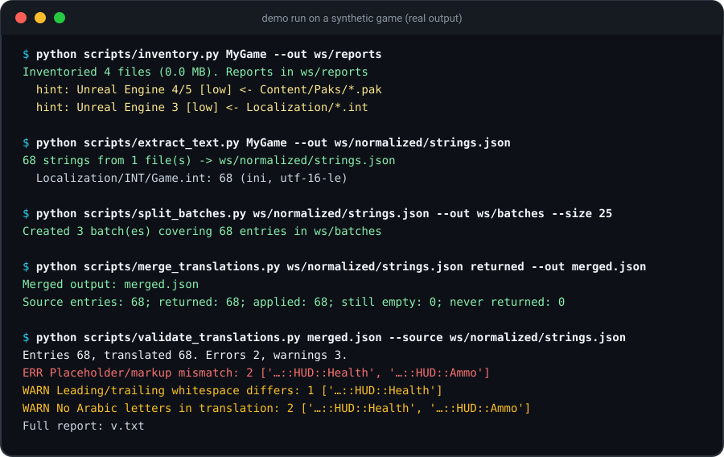
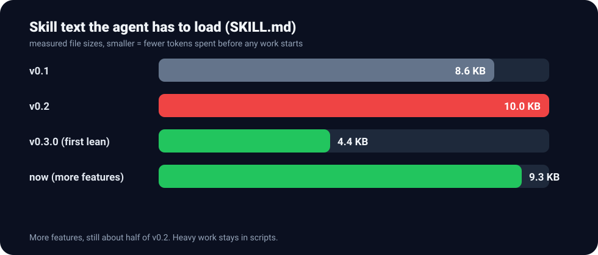
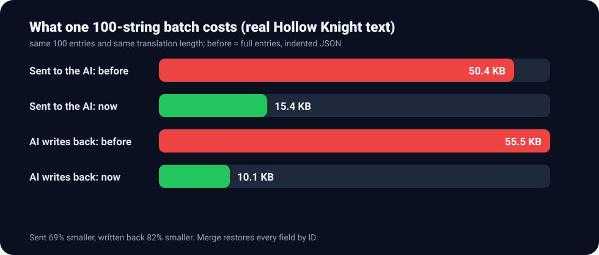

<p align="center">
  
</p>

<p align="center">
  <b>Turn a game folder into translation-ready batches, then into a translated patch.<br>Built for people on free AI limits.</b>
</p>

<p align="center">
  <a href="https://github.com/ADMOSSx/Universal-Game-Localization/actions/workflows/selftest.yml"></a>
  <a href="LICENSE"></a>
  
  
  
  
</p>

<p align="center">
  <a href="#-install">Install</a> ·
  <a href="#-how-it-works">How it works</a> ·
  <a href="#-see-it-run">Demo</a> ·
  <a href="#-scripts">Scripts</a> ·
  <a href="#-limitations">Limitations</a> ·
  <a href="#العربية">العربية</a>
</p>

---

## ✨ Why this exists

Most "AI localization" setups burn through free limits before a single string is translated. This skill flips that: **scripts do the boring work for free, and the AI only touches what really needs intelligence.**

| | |
|---|---|
| 🪶 **Featherweight** | The skill file is ~4 KB, references load only when needed, and the agent keeps one short notes file instead of a pile of reports. |
| 🧰 **Scripts, not tokens** | Inventory, extraction, batching, merging, validation and patch-building are plain Python. Zero tokens. |
| 🔒 **Your game stays untouched** | Read-only on the game folder. Output is translated *copies* with SHA-256 checksums. No anti-cheat/DRM bypass. |
| 🌍 **Arabic / RTL aware** | Checks for pre-shaped letters, stray bidi marks, mojibake and overflow, plus a test-string set and a rendering checklist. |
| 🧪 **Honest about limits** | Binary formats are reported as `BLOCKED` with next steps, never guessed. |

## 🚀 Install

Needs [Node.js](https://nodejs.org). One command, global, for OpenCode:

```bash
npx skills add ADMOSSx/Universal-Game-Localization --skill universal-game-localization -g -a opencode -y
```

Restart OpenCode, then ask:

> Use the universal-game-localization skill. Analyze this game folder: `D:\Games\MyGame`. Prepare it for Arabic localization. Do not modify the original game.

<details>
<summary><b>🤖 Let your AI agent install it</b></summary>

Paste this into OpenCode (or any coding agent):

> Install the agent skill from https://github.com/ADMOSSx/Universal-Game-Localization. Run `npx skills add ADMOSSx/Universal-Game-Localization --skill universal-game-localization -g -a opencode -y`. If npx is not available, clone the repo and copy the folder `skills/universal-game-localization` into `~/.config/opencode/skills/` (on Windows: `%USERPROFILE%\.config\opencode\skills\`). Then run `python scripts/selftest.py` inside that folder and tell me if it prints SELFTEST PASSED.

</details>

<details>
<summary><b>📦 Manual install</b></summary>

Download the repo (**Code → Download ZIP**) and copy `skills/universal-game-localization` to `%USERPROFILE%\.config\opencode\skills\` so that `...\skills\universal-game-localization\SKILL.md` exists. Restart OpenCode. Per-project installs (`.opencode/skills/`) also work, see the [OpenCode skills docs](https://opencode.ai/docs/skills).

</details>

<details>
<summary><b>✅ Check that the scripts work on your machine</b></summary>

Requires **Python 3.10+**.

```powershell
cd "%USERPROFILE%\.config\opencode\skills\universal-game-localization"
python scripts\selftest.py        # last line: SELFTEST PASSED
```

</details>

> [!NOTE]
> `npx skills` is a third-party CLI (from Vercel) that collects anonymous usage stats. Set `DO_NOT_TRACK=1` to disable it.

## 🧭 How it works

<p align="center">
  
</p>

1. **Inventory + engine adapters** scan read-only. The structured adapter report distinguishes Unity Mono/IL2CPP, Unreal 3 vs 4/5 (including IoStore clues), and Godot project/PCK layouts, then lists likely localization paths and safe next steps.
2. **Extract** pulls strings from `.ini .int .properties .lng .json .csv .tsv .txt` into one normalized `strings.json`.
3. **Deduplicate** collapses exact repeated strings only when context, speaker, tags, formatting and length constraints match. Unknown context is scoped to its source file.
4. **Batch** splits unique entries into small, ID-stable JSON files. The token budget includes prompt overhead and a reserved response estimate.
5. **Translate** happens in any free chat AI you like, outside the agent. The translator returns only `id` + `translation` (and optional review notes), not the full source metadata.
6. **Resume** uses `resume_batches.py` to create pending-only files after an interrupted or partial translation, preserving IDs and batch filenames.
7. **Expand + validate** restores duplicate IDs from a SHA-256-bound map, then checks placeholders, markup, changed originals, encoding damage and overflow risks.
8. **Patch** writes translated copies, keeping each file's original encoding, BOM and line endings.

## 🎬 See it run

<p align="center">
  
</p>

That is real output on a synthetic demo game. Note the last step: the validator caught two translations that dropped a placeholder (`%d` and `{1}`), the kind of bug that crashes or garbles text in-game.

## 🧰 Scripts

All in `skills/universal-game-localization/scripts/`, Python standard library only, **0 AI tokens**.

| Script | What it does |
|---|---|
| `inventory.py` | Read-only audit: extensions, magic bytes, engine hints, localization candidates, fonts, archives |
| `engine_adapters.py` | Structured Unity / Unreal / Godot detection, candidate paths and safe next steps |
| `extract_text.py` | Plain-text formats → `normalized/strings.json` + `files.json` with source SHA-256 hashes; refuses output inside the game |
| `deduplicate_strings.py` | Collapses exact duplicates with matching context/speaker/format constraints; writes a source-hash-bound ID map |
| `deduplicate_strings.py` / `expand_translations.py` | Optional: translate exact repeats once (same context and limits), then restore every ID with a hash-checked map |
| `status.py` | Progress in 3 lines: done / needs_review / missing, and the next command |
| `split_batches.py` | Batches by count/characters/serialized bytes and total estimated prompt + input + response budget |
| `resume_batches.py` | Builds pending-only batches from partial returns while preserving original IDs and batch filenames |
| `merge_translations.py` | Merges compact returned `id` + `translation` records by ID; restores untouched metadata from source |
| `expand_translations.py` | Reuses representative translations for duplicate IDs and restores the original normalized dataset |
| `validate_translations.py` | Placeholders/markup, mojibake, whitespace, untranslated text, Arabic checks, length risks |
| `inject_text.py` | Source-hash verification, safe relative paths, no overwrite by default, translated copies + manifest |
| `make_handoff.py` | Builds a verified ZIP, skips symlinks and likely secrets, redacts local paths, protects existing folders |
| `unity_fonts.py` | Unity only, optional (`pip install UnityPy fonttools`): lists Font assets inside `.assets` files and which characters of your translation each font lacks. Tested on one real file, not in CI |
| `selftest.py` | End-to-end test including byte-for-byte round trips |

### Supported today

| Format | Status |
|---|---|
| `.ini` `.int` `.properties` `.lng` (UTF-8, UTF-16, BOM, CRLF, quoted values) | ✅ extract + inject |
| `.json` · `.csv` / `.tsv` · `.txt` | ✅ extract + inject (JSON/CSV are re-serialized, the script warns) |
| `.pak` `.upk` `.assets` `.vpk` `.pck` and other binary archives | ⚠️ not handled by scripts; the skill finds a tool and asks before installing |

## 🪶 Lean by design

<p align="center">
  
</p>

<p align="center">
  
</p>

Batches now carry only what the translator needs (`id`, `original`, useful context and length limits). The AI writes back just `id` + `translation`, and the merge step restores every other field by ID. Measured on real Hollow Knight text: about 69% less sent and 82% less written back.

## ⚠️ Limitations

- Binary archives and proprietary formats are **not** extracted by the scripts.
- Token counts from `split_batches.py` include configurable prompt overhead and response reserve, but remain heuristic estimates rather than exact model-tokenizer measurements.
- Duplicate reuse is conservative: it requires exact original text plus matching context, speaker, notes, placeholders, tags, formatting and metadata. Unknown context is limited to the same source file; missing source-file information prevents cross-entry reuse.
- Extraction refuses to overwrite existing `strings.json` / `files.json` unless `--force` is specified.
- Patch creation requires source hashes from a fresh extraction; old metadata needs explicit `--allow-unverified-source`.
- Patch manifests and translated files are protected from accidental overwrite unless `--force` is specified.
- Arabic display depends on the game's font and text renderer. The skill gives a checklist and test strings, but **only an in-game test proves it works**.
- Engine detection is hint-based, never 100% certain.
- Online or multiplayer games with anti-cheat are out of scope; the skill stops and explains.

> [!IMPORTANT]
> Extracted game text belongs to its owners. Use it for your own localization work, do not publish it, and respect each game's license and local law. This project is not affiliated with OpenCode, Anthropic, or any game publisher.

## 🤝 Contributing

The most useful help right now: **try it on a real game** and add the result to [docs/SUPPORTED_GAMES.md](docs/SUPPORTED_GAMES.md). See [CONTRIBUTING.md](CONTRIBUTING.md) and the [CHANGELOG](CHANGELOG.md).

## 📄 License

[MIT](LICENSE)

---

<div dir="rtl">

## العربية

<a name="العربية"></a>

**Universal Game Localization Skill** هي skill خفيفة لـ [OpenCode](https://opencode.ai) تساعدك على **تجهيز أي لعبة للترجمة** (مع اهتمام خاص بالعربية واتجاه الكتابة من اليمين لليسار): فحص مجلد اللعبة، تحديد المحرك (engine)، استخراج النصوص، تقسيمها إلى دفعات (batches)، فحص الترجمة، وبناء باتش - مع استهلاك أقل قدر ممكن من التوكن.

صُممت للمستخدمين على **الحدود المجانية** للذكاء الاصطناعي: ملف الـ skill صغير (~4KB)، والعمل الثقيل تقوم به سكريبتات بايثون **بدون أي توكن**، والترجمة نفسها تتم في أي AI مجاني تختاره، وليس داخل الـ agent.

> هذه أداة تجهيز وليست استخراجًا سحريًا. الصيغ النصية العادية تعمل مباشرة، أما الصيغ الثنائية (`.pak` و`.upk` و`.assets`...) فتحتاج أداة خارجية، والـ skill ستخبرك بذلك بدل التخمين.

### طريقة العمل

1. **الجرد**: فحص للقراءة فقط مع ملخص مضغوط وتلميحات عن المحرك.
2. **الاستخراج**: من `.ini .int .properties .lng .json .csv .tsv .txt` إلى ملف `strings.json` موحّد.
3. **إزالة التكرار**: يجمع النصوص المتطابقة فقط عند تطابق السياق والمتحدث والتنسيق وحدود الطول، ويوفر ترجمة واحدة للمجموعة.
4. **التقسيم**: دفعات أصغر بحساب تقديري لتكلفة التعليمات والمدخلات والرد.
5. **الترجمة**: يطلب من AI إرجاع `id` والترجمة فقط، بدل إعادة كل بيانات المصدر.
6. **الاستكمال**: يعيد الدفعات الناقصة أو التي تحتاج مراجعة.
7. **توسيع وفحص**: يعيد الترجمة لكل IDs الأصلية، ثم يفحص المتغيرات والتنسيق والترميز والطول.
8. **الحقن**: يكتب **نسخًا** مترجمة من الملفات (بنفس الترميز ونهايات الأسطر) مع ملف checksums. مجلد اللعبة لا يُمَس أبدًا.

### التثبيت

**الطريقة 1 - أمر واحد (الأفضل):** تحتاج [Node.js](https://nodejs.org). هذا الأمر يثبّتها لـ OpenCode بشكل عام وبدون أسئلة:

```bash
npx skills add ADMOSSx/Universal-Game-Localization --skill universal-game-localization -g -a opencode -y
```

احذف `-g` للتثبيت داخل المشروع الحالي فقط. ثم أعد تشغيل OpenCode.

**الطريقة 2 - اجعل الـ AI يثبّتها:** الصق في OpenCode هذه الرسالة:

> ثبّت الـ skill من https://github.com/ADMOSSx/Universal-Game-Localization بتشغيل `npx skills add ADMOSSx/Universal-Game-Localization --skill universal-game-localization -g -a opencode -y`. وإن لم يتوفر npx فاستنسخ المستودع وانسخ المجلد `skills/universal-game-localization` إلى `%USERPROFILE%\.config\opencode\skills\`. ثم شغّل `python scripts/selftest.py` داخل المجلد وأخبرني هل ظهر SELFTEST PASSED.

**الطريقة 3 - يدويًا:** حمّل المستودع (Download ZIP) وانسخ `skills/universal-game-localization` إلى `%USERPROFILE%\.config\opencode\skills\` ثم أعد تشغيل OpenCode.

بعد التثبيت اكتب:
> Use the universal-game-localization skill. Analyze this game folder: `D:\Games\MyGame`. Prepare it for Arabic localization. Do not modify the original game.

يتطلب **Python 3.10 أو أحدث**. للتأكد أن السكريبتات تعمل: شغّل `python scripts\selftest.py` داخل مجلد الـ skill، ويجب أن يظهر `SELFTEST PASSED` في آخر سطر.

### حدود يجب معرفتها

- الأرشيفات الثنائية والصيغ الخاصة لا تستخرجها السكريبتات.
- ملفات JSON وCSV يُعاد كتابتها عند الحقن (المحتوى سليم، لكن المسافات أو علامات الاقتباس قد تتغير، وسيحذّرك السكريبت).
- ظهور العربية صحيحًا يعتمد على خط اللعبة ومحرك عرض النص. **التجربة داخل اللعبة هي الدليل الوحيد.**
- الألعاب الأونلاين التي تستخدم حماية (anti-cheat) خارج النطاق.

### الأمان والقانون

- مجلد اللعبة للقراءة فقط؛ الاستخراج والحقن يتحققان من المسارات والروابط الرمزية وبصمة SHA-256 للمصدر.
- إعادة الاستخراج لا تستبدل ملفات `strings.json` و`files.json` الموجودة إلا باستخدام `--force`.
- إنشاء الباتش لا يستبدل ملفات أو Manifest موجودة افتراضيًا؛ استخدم `--force` فقط بعد مراجعة المسارات.
- حساب الـ Tokens يشمل هامشًا للتعليمات والرد المتوقع، لكنه يظل تقديريًا وليس عددًا دقيقًا من tokenizer الخاص بالموديل.
- إعادة استخدام الترجمة لا تحدث إلا مع تطابق النص والسياق والمتحدث والقيود؛ والسياق المجهول يقتصر على الملف نفسه.
- لا تثبيت تلقائي، ولا تشغيل لملفات تنفيذية مجهولة، ولا تجاوز لحماية اللعبة.
- نصوص اللعبة المستخرجة محمية بحقوق أصحابها: استخدمها لعملك الشخصي ولا تنشرها، والتزم بشروط اللعبة والقوانين المحلية.
- المشروع غير تابع لـ OpenCode أو Anthropic أو أي ناشر ألعاب.

### المساهمة

اقرأ [CONTRIBUTING.md](CONTRIBUTING.md). أكثر مساعدة مفيدة الآن: **جرّب على ألعاب حقيقية** وأضف نتيجتك في [docs/SUPPORTED_GAMES.md](docs/SUPPORTED_GAMES.md).

</div>
